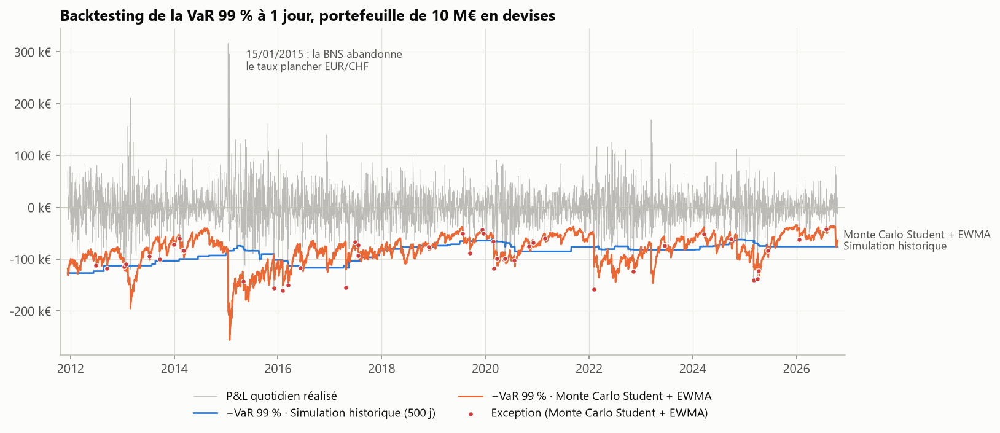
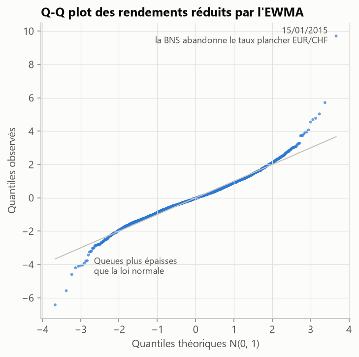
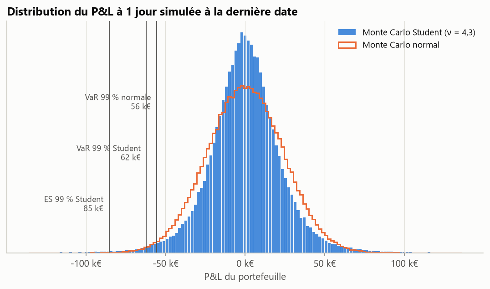
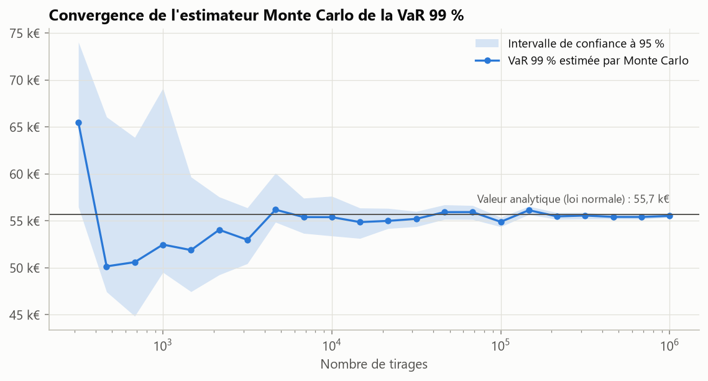

# VaR et Expected Shortfall d'un portefeuille de devises

[](https://github.com/narusly/var-monte-carlo/actions/workflows/tests.yml)

Mesure du risque de change d'un portefeuille de 10 M€ (USD, GBP, JPY, CHF) sur 16 ans de taux officiels
de la BCE : quatre méthodes de VaR et d'Expected Shortfall, dont deux par simulation de Monte Carlo,
comparées par un backtesting de près de 15 ans.

## En bref

- **Les queues de distribution comptent.** Le Monte Carlo gaussien à volatilité dynamique (EWMA) sous-estime
  le risque : 55 dépassements de la VaR 99 % pour 38 attendus, modèle **rejeté par le test de Kupiec**
  (p = 0,009). La même simulation avec une loi de Student (ν ≈ 4) passe : 43 dépassements, p = 0,43.
- **Réactivité contre stabilité.** La simulation historique sur 500 jours passe les tests sur l'ensemble de la
  période, mais réagit en escalier et reste élevée deux ans après un choc ; le modèle EWMA-Student suit les
  régimes de volatilité au jour le jour.
- **ES et FRTB.** Sous hypothèse normale, l'ES à 97,5 % (mesure retenue par la FRTB) et la VaR à 99 % sont
  quasi égales (2,34σ contre 2,33σ). Avec des queues épaisses, l'ES 97,5 % dépasse la VaR 99 % :
  65,9 k€ contre 62,7 k€ à la dernière date.



## Problème

Quelle perte un investisseur en euros peut-il subir en un jour sur ses positions en devises, dans 99 % des
cas, et combien perd-il en moyenne au-delà ? Une seule méthode ne suffit pas : il faut vérifier, données à
l'appui, qu'elle aurait tenu dans le passé.

## Données

- **Source** : taux de change de référence de l'euro publiés par la BCE (API publique, sans clé), du
  05/01/2010 au 19/10/2026, soit 4 300 jours ouvrés. Le fichier est versionné dans `data/` pour que les
  résultats soient reproductibles. *Source : Banque centrale européenne.*
- **Portefeuille** : USD 4,0 M€, GBP 2,5 M€, JPY 2,0 M€, CHF 1,5 M€.
- **Rendements** : la BCE cote S = unités de devise pour 1 €. Une unité de devise vaut 1/S euros, donc son
  log-rendement en euros vaut −Δlog S.

## Méthode

| Modèle | Volatilité | Loi des rendements | Calcul |
|---|---|---|---|
| Simulation historique | fenêtre de 500 jours | empirique | rejeu des rendements passés |
| Variance-covariance | covariance sur 500 jours | normale | formule fermée |
| Monte Carlo normal + EWMA | RiskMetrics, λ = 0,94 | normale multivariée | 20 000 tirages par jour |
| Monte Carlo Student + EWMA | RiskMetrics, λ = 0,94 | Student multivariée, ν estimé | 20 000 tirages par jour |

- **Réévaluation complète** : chaque position vaut exposition × e^r, pas d'approximation linéaire dans les
  modèles simulés.
- **Student multivariée** : Z·√((ν−2)/ν) / √(W/ν), avec Z gaussien corrélé (Cholesky) et W ~ χ²(ν), ce qui
  conserve exactement la matrice de covariance. ν est estimé chaque jour par maximum de vraisemblance sur
  les rendements du portefeuille réduits par la volatilité EWMA.
- **Backtesting sans regard vers le futur** : la VaR du jour t n'utilise que les données jusqu'à t−1
  (vérifié par un test).
- **Tests statistiques** : Kupiec (fréquence des dépassements), Christoffersen (indépendance : un dépassement
  en annonce-t-il un autre ?), et feux de Bâle sur les 250 derniers jours.
- **Précision du Monte Carlo** : intervalle de confiance de la VaR par statistiques d'ordre (loi binomiale),
  sans hypothèse sur la loi du P&L.

## Résultats

Backtesting de la VaR 99 % à 1 jour, du 12/12/2011 au 19/10/2026 (3 800 jours, 38 dépassements attendus) :

| Modèle | Dépassements | Taux | p Kupiec | p Christoffersen | Feux de Bâle (250 j) |
|---|---:|---:|---:|---:|---|
| Simulation historique (500 j) | 45 | 1,18 % | 0,267 | 0,563 | vert (0) |
| Variance-covariance (500 j) | 41 | 1,08 % | 0,629 | 0,466 | vert (0) |
| Monte Carlo normal + EWMA | **55** | **1,45 %** | **0,009** | 0,204 | vert (3) |
| Monte Carlo Student + EWMA | 43 | 1,13 % | 0,425 | 0,321 | vert (2) |

Aucun modèle n'est rejeté par le test d'indépendance au seuil de 5 %. Le détail, avec la VaR et l'ES à
99 % et 97,5 % à la dernière date, est dans [`reports/resultats.md`](reports/resultats.md).

<table>
<tr>
<td></td>
<td></td>
</tr>
</table>

Les rendements réduits par l'EWMA restent leptokurtiques (kurtosis en excès de 4,3). Le point à 10σ est le
15/01/2015, jour où la Banque nationale suisse a abandonné le taux plancher EUR/CHF.



Avec 20 000 tirages, la demi-largeur de l'intervalle de confiance à 95 % de la VaR 99 % est d'environ
2,3 % : suffisant pour un backtest quotidien. Il faut environ 100 000 tirages pour passer sous 1 %, et un
million pour atteindre 0,3 % (précision en 1/√n).

## Limites et pistes

- Horizon 1 jour seulement. Le passage à 10 jours (règle de la racine du temps, ou simulation de chemins)
  serait la suite naturelle.
- Une seule classe d'actifs. Des actions ou des taux ajouteraient des facteurs non linéaires (options,
  convexité), où la réévaluation complète prend tout son sens.
- Le choix λ = 0,94 est celui de RiskMetrics. Un GARCH(1,1) estimé, et un ν propre à chaque devise (copule
  de Student), seraient plus fins.

## Reproduire

```bash
python -m venv .venv
source .venv/bin/activate            # Windows : .venv\Scripts\activate
pip install -e ".[dev]"
pytest                               # 17 tests
python -m varmc.report               # régénère reports/ (environ 1 minute)
python -c "from varmc.data import load_rates; load_rates(refresh=True)"   # met à jour les taux BCE
```

## Structure

```
src/varmc/data.py       téléchargement BCE, rendements en euros
src/varmc/models.py     VaR et ES : historique, variance-covariance, EWMA, Monte Carlo normal et Student
src/varmc/backtest.py   VaR glissante, tests de Kupiec et de Christoffersen, feux de Bâle
src/varmc/report.py     analyse complète, tableaux et figures
tests/                  propriétés mathématiques et absence de regard vers le futur
```

---
Maxime Fruntes · Master 2 Mathématiques appliquées (Probabilités et Statistiques), Université de Lorraine ·
[LinkedIn](https://www.linkedin.com/in/maxime-fruntes-2538543a5/) · Licence MIT
